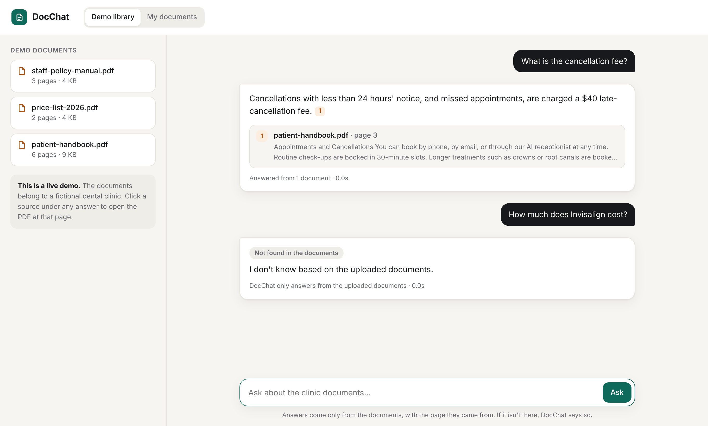

# DocChat: chat with your documents



Upload PDFs (handbooks, policies, price lists, contracts) and ask questions in plain English. Every answer shows **which document and which page** it came from; click a source to open the PDF at that page. If the answer isn't in the documents, DocChat says **"I don't know"** instead of guessing.

Built for clinics, law firms, schools and HR teams. Each customer gets a private workspace, and there's a public demo anyone can try without signing up.

```
Upload PDF ──► extract text per page (pdf.js) ──► chunks (≤800 tokens, overlap, never cross a page)
                                                   │
                                                   ▼
                       Gemini (free) or OpenAI embeddings ──► Supabase Postgres + pgvector
                                                                    (workspace id, document, page)
Question ──► embed ──► top 5 chunks in THIS workspace only ──► nothing relevant? → "I don't know" (no AI call)
                                                   │
                                                   ▼
                       Claude Haiku: answer ONLY from these sources, cite [1][2] ──► answer + clickable page sources
```

## Stack and why

| Part | Choice | Why |
|---|---|---|
| Server | Node.js + Express | Runs as a managed Node.js app on Hostinger Business. No Python hosting needed |
| PDF text | pdf.js (Mozilla) | Reliable text extraction per page. Running headers/footers are stripped automatically |
| Vectors, database, login, file storage | Supabase (pgvector + Auth + Storage) | One free service replaces Pinecone + a database + an auth provider |
| Embeddings | Google `gemini-embedding-001` (free tier) or OpenAI `text-embedding-3-small` | Gemini's free tier costs nothing to start; OpenAI is a very cheap paid option |
| Answers | Claude Haiku | Fast, cheap, and follows the "only from the sources" rule well |
| Front end | Plain HTML/JS, no build step | Nothing to compile; upload and run |

## What's in this folder

| Path | What it is |
|---|---|
| `server.js` | API + serves the web app |
| `lib/pdf.js` | Text extraction, header/footer removal, page-aware chunking |
| `lib/ai.js` | Embeddings + Claude answer prompt (with offline mocks for testing) |
| `lib/rag.js` | The pipeline: ingest a PDF, answer a question with citations |
| `lib/store.js` | Supabase storage, plus an in-memory store for local testing |
| `supabase/schema.sql` | Tables, vector index, search function, private file bucket |
| `public/` | The chat app (demo library, private workspace, upload, citations, login) |
| `sample-docs/` | Demo PDFs for a fictional clinic (handbook, price list, staff manual) |
| `scripts/seed-demo.js` | Loads `sample-docs/` (or your own folder) into the public demo |
| `scripts/eval.js` + `eval/questions.json` | 20-question accuracy test that writes `eval-results.md` |
| `scripts/make-sample-docs.py` | Regenerates the demo PDFs |

## Try it locally in 1 minute (no accounts, no keys)

Needs Node.js 22+.
```bash
npm install
npm run dev          # offline mode: in-memory storage + mock AI
```
Open http://localhost:3000. The demo documents load automatically. Mock mode is only for checking that everything works: it picks a matching sentence instead of really answering. Real answers need the API keys below.

## Setup (about 30 minutes)

### 1. Supabase (free)
1. Create a project at **supabase.com** → New project. Pick the region closest to your customers.
2. **SQL Editor → New query** → paste all of `supabase/schema.sql` → **Run**.
3. **Project Settings → API**: copy the **Project URL**, the **anon public** key and the **service_role** key. The service_role key is a master key: it only goes in the server's environment variables, never in the browser or in Git.
4. **Authentication → URL Configuration**: set **Site URL** to your live address (for example `https://docchat.yourdomain.com`), so confirmation emails link back to your site.
5. Optional for demos: **Authentication → Sign In / Providers → Email** → turn off "Confirm email" so new users can sign in immediately.

### 2. API keys
- **Embeddings, free:** aistudio.google.com → sign in with Google → **Get API key** → **Create API key**. No card needed. Put it in `GEMINI_API_KEY`.
  Note: on Google's free tier, Google may use the text you send to improve its products. That's fine for demos; for a paying client's private documents, turn on billing in Google AI Studio (very cheap) or use OpenAI instead.
- **Embeddings, paid alternative:** platform.openai.com → API keys → `OPENAI_API_KEY`. Pick one provider and stay with it: switching later means re-uploading the documents.
- **Anthropic**: the same Claude key as your other projects.

### 3. Run with the real services
```bash
cp .env.example .env      # fill in the keys
npm run seed              # loads sample-docs/ into the public demo
npm start
```

### 4. Measure accuracy (for the case study)
```bash
npm run eval
```
This asks the 20 questions in `eval/questions.json` (16 answerable, 4 that are not in the documents) and writes `eval-results.md` with the score, response time and token use. An answerable question only passes if the answer has the right facts **and** cites the right page; an unanswerable one only passes if DocChat says "I don't know". For a client, replace the questions with ones about their documents.

## Deploy to Hostinger (Business plan)
1. Push this folder to GitHub (the `.gitignore` keeps `node_modules` and `.env` out), or zip it without `node_modules`.
2. hPanel → **Websites → Add website → Node.js Apps** → import from GitHub (or upload the zip).
3. Settings: **Node.js 22**, start command `npm start`, entry file `server.js`.
4. **Environment variables**: `GEMINI_API_KEY` (or `OPENAI_API_KEY`), `ANTHROPIC_API_KEY`, `SUPABASE_URL`, `SUPABASE_ANON_KEY`, `SUPABASE_SERVICE_ROLE_KEY`.
5. Deploy, then attach a domain or subdomain (for example `docchat.yourdomain.com`). Hostinger provides HTTPS.
6. Open `/api/health`. It should show `"store":"supabase","ai":"live"`.

## How it stays accurate
- **Exact page citations.** Chunks never cross a page break, so every source points to one page.
- **Two "I don't know" gates.** If no chunk is similar enough, the app answers "I don't know" without calling Claude. If chunks are found but don't contain the answer, Claude's instructions require it to say "I don't know".
- **Prompt-injection safe.** Document text is passed as data inside `<source>` tags, and Claude is told to ignore instructions inside it.
- **Tenant isolation.** Every search is filtered by the signed-in user's workspace inside the database function. The browser never gets database access: tables have row-level security on, and the search function can only be called by the server.

## Cost

| Item | Approx. cost |
|---|---|
| Indexing a 100-page PDF (embeddings) | well under $0.01, one time |
| One question (embedding + Claude Haiku reading 5 chunks) | about half a cent |
| Off-topic questions | almost free: no Claude call when nothing relevant is found |
| Supabase free tier | 500 MB database + 1 GB files: thousands of pages per customer |
| Hostinger | included in your Business plan |

Indexing is free on Gemini's free tier. Model prices change, so check ai.google.dev/pricing, openai.com/api/pricing and anthropic.com/pricing before quoting. The `eval` report shows real token use you can multiply out.

Built-in cost guards: public demo limited to 20 questions per visitor per hour and 500 per day in total; signed-in users to 120 per hour; 10 MB / 300 pages per PDF; 20 documents per workspace. All can be changed with environment variables (see `.env.example`).

## Selling it
**DocChat for clinics, law firms, schools and HR:** "Your staff and customers get instant answers from your own documents, with the page to prove it."

| Plan | Price | Limits to set |
|---|---|---|
| Starter | $19/mo | 5 documents, 1 user |
| Team | $49/mo | 50 documents |
| Business | $99/mo | 200 documents + an embeddable widget for their website |

Or sell it as a one-off build: their documents, their branding, deployed on their domain, plus a monthly fee for hosting and support. Projects 4 and 5 (the support chatbot and the internal assistant) can reuse this as their knowledge base: they call `ask()` from `lib/rag.js` with the client's workspace.

## Limitations (be upfront with clients)
- Scanned PDFs (images of text) have no selectable text. They're rejected with a clear message; run them through OCR first.
- Each question is answered on its own; follow-ups like "and for children?" need the full question.
- Tables are read as text. Simple price tables work well, complex multi-column tables less so.

## Troubleshooting

| Problem | Fix |
|---|---|
| `/api/health` shows `"store":"memory"` | `SUPABASE_URL` or `SUPABASE_SERVICE_ROLE_KEY` missing in the environment |
| Upload fails with "save chunks" or "search" error | `supabase/schema.sql` wasn't run, or ran with an error. Run it again |
| Every answer is "I don't know" | Demo not seeded (`npm run seed`), or `MIN_SIMILARITY` set too high. Try 0.2 |
| "OPENAI_API_KEY is not set" | You meant to use Gemini: set `GEMINI_API_KEY` (and leave `OPENAI_API_KEY` empty) |
| "Gemini embeddings: quota" / 429 errors | Free-tier rate limit. Wait a minute and retry, or enable billing in AI Studio |
| Claude model error | Set `CLAUDE_MODEL` to a model your key has access to |
| Sign-up email link goes to localhost | Set the Site URL in Supabase (step 1.4) |
| Sign in button missing | `SUPABASE_ANON_KEY` not set |

## Author
Built by **Ahmad Murtaza**, AI automation and web developer. Want DocChat for your business's documents? Get in touch on [Upwork](https://www.upwork.com/freelancers/ahmadmurtaza31).
